# 구랜디 (GuRandi) — AI 에이전트 팀으로 만든 3D 랜덤 디펜스

워크래프트3 유즈맵 「원피스 랜덤 디펜스」를 Unity 6로 옮긴 협동 랜덤 디펜스 게임입니다.
**기획·지시·검증·배포 판단은 제가 하고, 구현은 Claude Code 에이전트 4명으로 꾸린 팀이 맡았습니다.**
이 저장소는 그 개발 방식을 보여 주는 소개용 저장소입니다. 게임 본 저장소는 원작 추출 데이터와 라이선스가 제한된 모델이 들어 있어 비공개이며, 요청하시면 열람 권한을 드립니다.

<p align="center">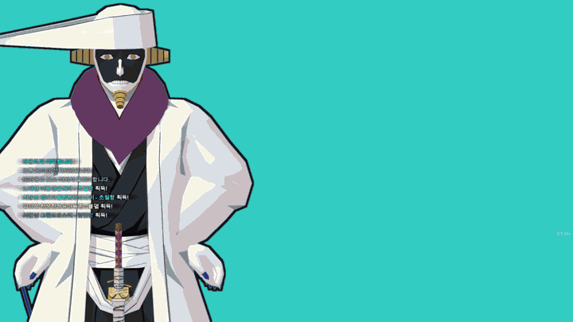</p>
<p align="center"><sub>상위 등급 유닛 컷인과 스킬 전투 · <a href="media/00_hero_cutin_combat.mp4">고화질 mp4</a></sub></p>

| | |
|---|---|
| 기간 | 2026.08.26 – 진행 중 (베타 0.3.24) |
| 엔진·언어 | Unity 6 (URP) · C# · Photon Fusion · NavMesh · Input System · Python · Blender |
| AI | Claude Max 5x ($100/월) · Claude Code (CLI) · Opus 5.5(PM) · Sonnet 5.5(팀원 3명) · MCP(Blender · Chrome) |
| 규모 | 커밋 3,331개 (그중 2,893개가 AI 공동 작성) · 런타임 C# 5.4만 줄 · 에디터 도구 C# 4만 줄 · Python 분석 도구 365개 |
| 배포 | 맥·윈도우 베타 30여 회 (친구들 대상 Google Drive 배포) |

## 게임 플레이

| 위습 → 뽑기 → 유닛 이동 | 컷인 4연속 → 상위 유닛 전투 |
|---|---|
| 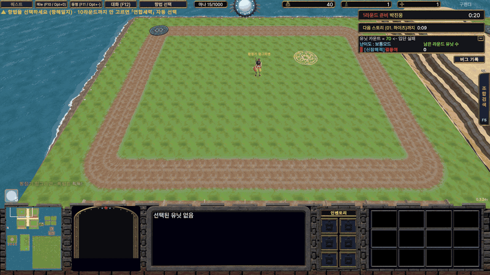 | 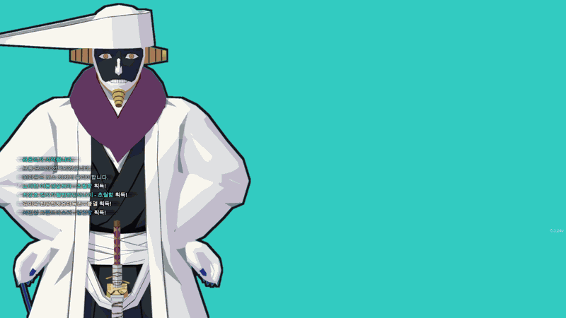 |
| [mp4 (20초)](media/01_flow_wisp_draw_combine.mp4) | [mp4 (10초)](media/02_cutin_and_combat.mp4) |

- 위습을 뽑기 포탈에 보내 무작위 유닛을 얻고, 같은 유닛이나 정해진 재료를 모아 상위 등급으로 조합합니다(13단계).
- 유닛 240여 기, 스킬 950여 개, 난이도 6종, 스토리 보스, 최대 4인 협동 멀티플레이를 지원합니다.
- 원작 맵 파일(w3x)의 유닛·능력 데이터(w3u·w3a)와 트리거(JASS)를 직접 디코드해 수치를 옮겼습니다.

| | |
|---|---|
| 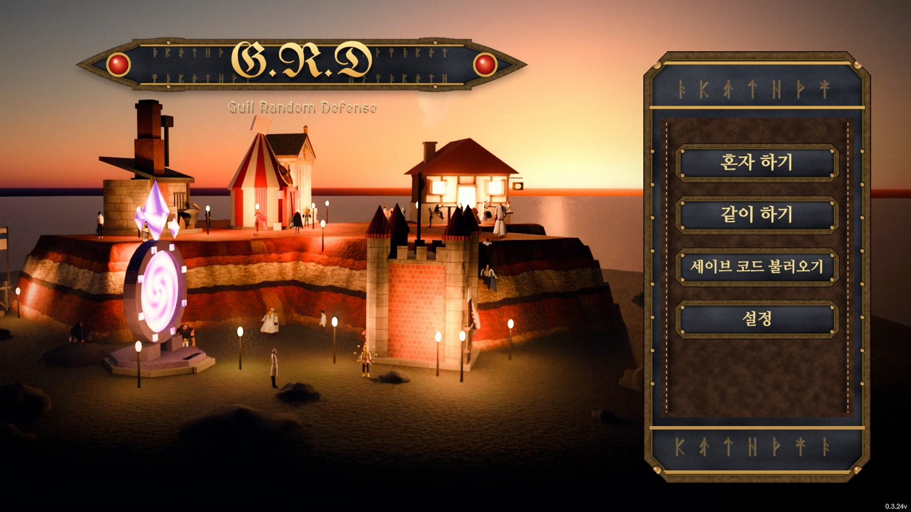 | 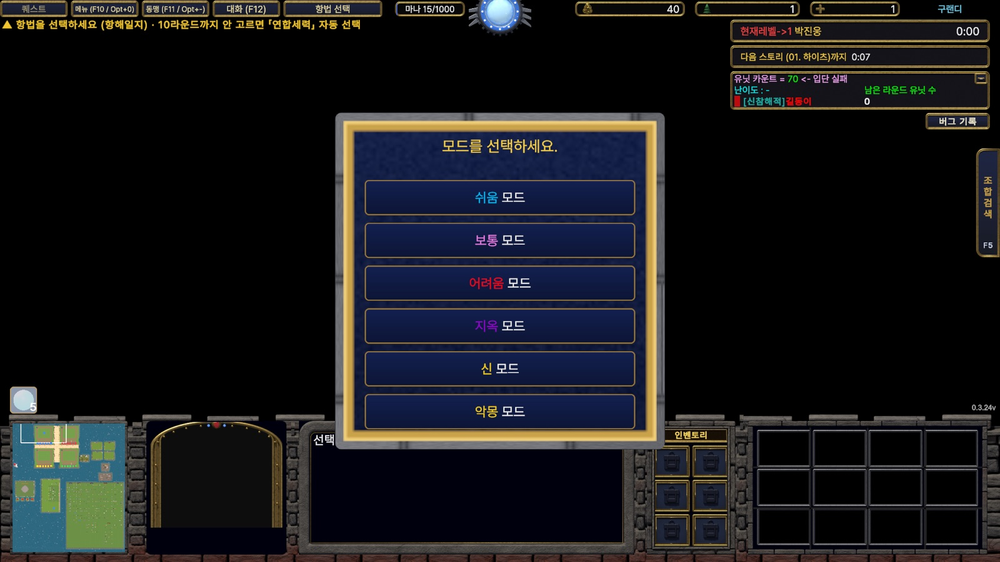 |
| 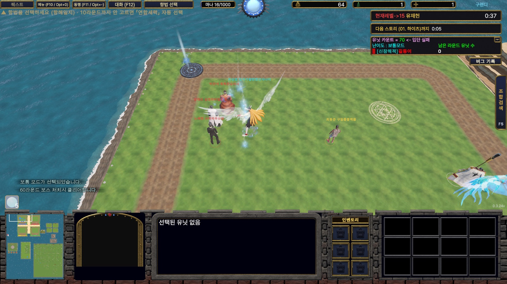 | 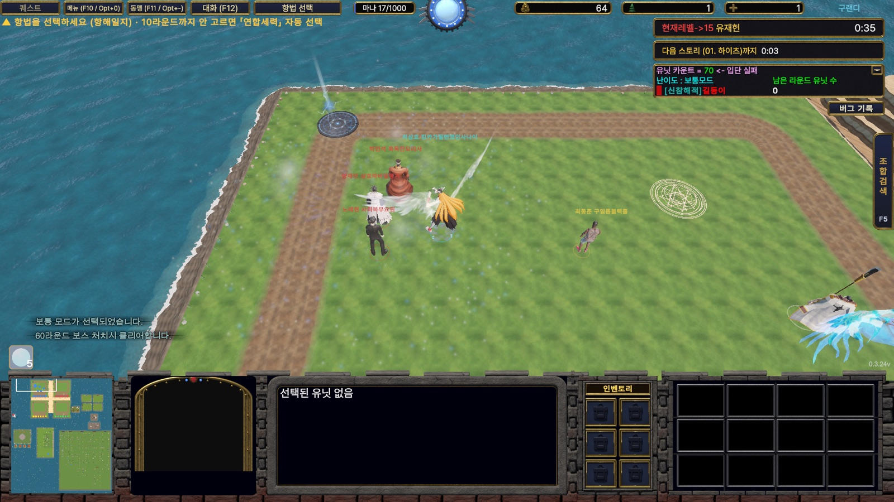 |
| 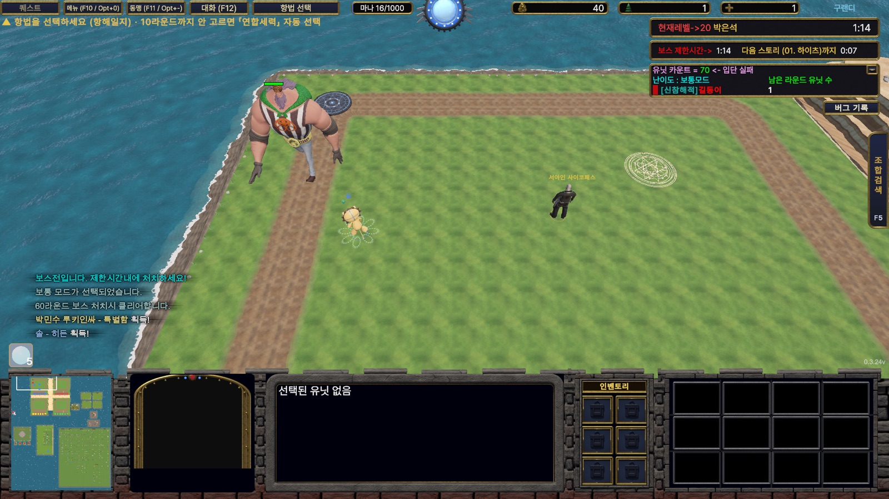 | 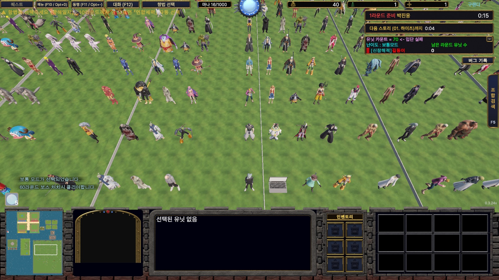 |
| 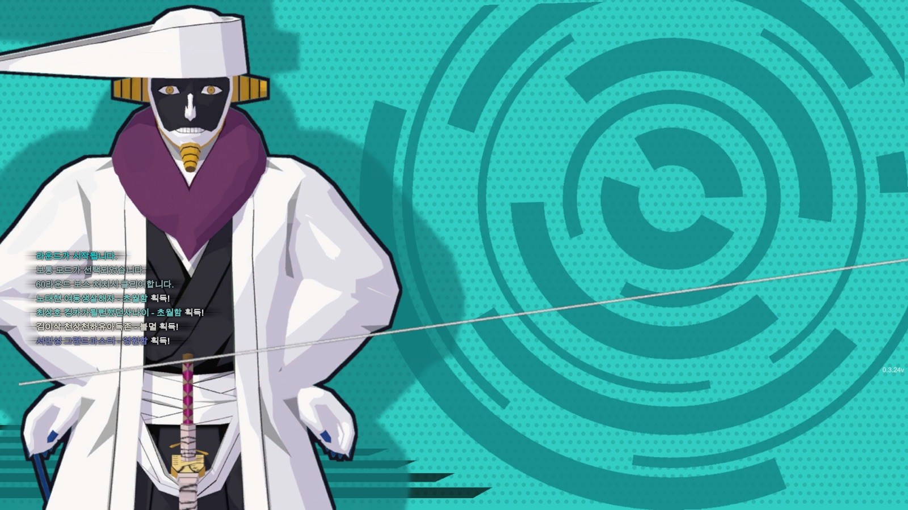 | 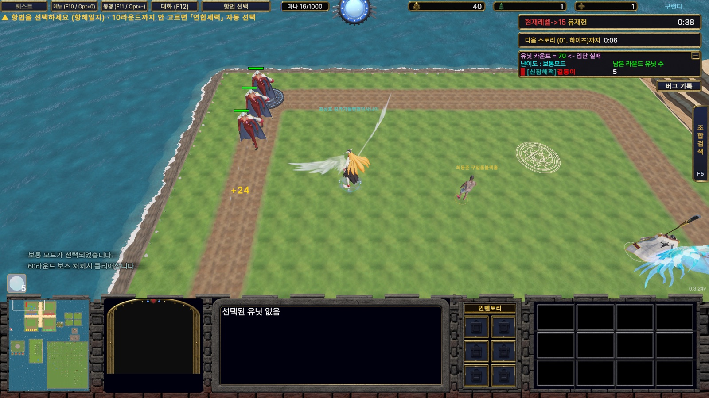 |

<sub>영상과 스크린샷은 AI 에이전트(구현담당2)가 에디터 브리지에 녹화 옵션을 직접 추가해 자동 플레이로 찍었습니다.</sub>

## AI 에이전트 팀 구조

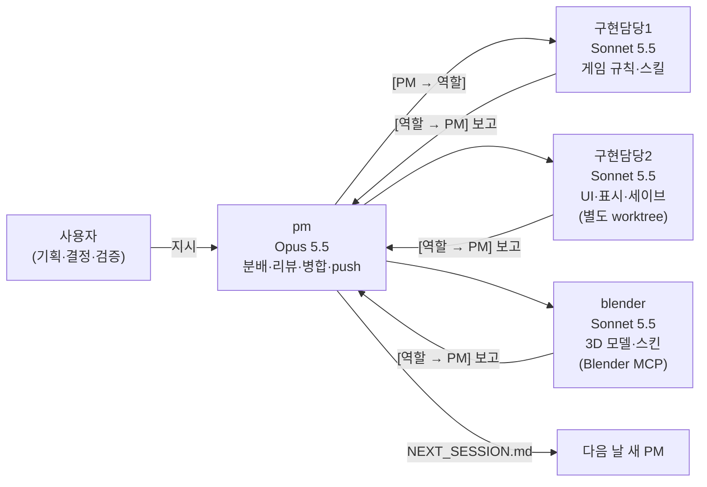

- **역할 분담:** 세션 4개를 PM·게임 규칙·UI·3D 모델로 나눴습니다. PM이 일을 나누고 코드 리뷰·병합·push를 맡습니다. 지시와 보고는 「[PM → 역할]」, 「[역할 → PM]」 형식으로 고정했습니다.
- **같은 규칙으로 시작:** 모든 세션은 시작할 때 [`CLAUDE.md`](docs/ai-workflow/CLAUDE.md)와 [`TEAM_RULES`](docs/ai-workflow/TEAM_RULES_excerpt.md)를 읽습니다. 팀원 지시문은 [`team/`](docs/ai-workflow/team)에 있고, [`spawn_team.sh`](docs/ai-workflow/team/spawn_team.sh) 하나로 셋을 새로 띄웁니다.
- **하루 단위 이어받기:** 세션이 끝날 때 PM이 [`NEXT_SESSION.md`](docs/ai-workflow/NEXT_SESSION_example.md)에 끝난 일 · 막힌 일 · 사용자 답을 기다리는 일을 정리합니다. 다음 날에는 「next.md 파일 읽고 진행해」 한 줄로 새 PM이 상태를 그대로 이어받습니다.
- **오래 가는 기억:** 사용자 결정과 반복된 실수는 한 사실당 파일 하나로 [메모리](docs/ai-workflow/memory)에 140여 개 쌓았습니다. 메모리는 판단 기준을, NEXT_SESSION은 오늘의 진행 상태를 담습니다.
- **요금제 안에서 운영:** 월 $100 한도 안에서 4세션을 돌리려고 판단·리뷰는 Opus, 반복 구현은 Sonnet으로 나눴습니다. 대화가 길어지면 PM이 스스로 인수인계를 쓰고 새 세션으로 갈아 끼웁니다([`spawn_pm.sh`](docs/ai-workflow/team/spawn_pm.sh)).

## AI가 직접 실행하고 확인하는 환경

AI가 「고쳤습니다」라고 말하는 것과 실제로 고쳐진 것은 다릅니다. 그래서 AI가 결과를 스스로 보고 확인할 수 있는 도구를 먼저 만들었습니다.

| 도구 | 하는 일 |
|---|---|
| [Unity 에디터 브리지](code-samples/ClaudeCommands_bridge_excerpt.cs) | AI가 `inbox/N.txt`에 명령을 쓰면 에디터가 실행하고 결과·로그·스크린샷을 `outbox`에 남깁니다. 플레이 모드 진입, 버튼 클릭, 자동 플레이(autoloop), 캡처까지 됩니다 |
| [원본 데이터 디코더](code-samples/tools/w3u.py) | 원작 맵의 유닛·능력 데이터를 직접 읽습니다. 수치의 근거는 문서가 아니라 이 디코드 결과만 씁니다 |
| [컴파일 검사](code-samples/tools/csc_check.sh) | 에디터를 켜지 않고 C# 컴파일 오류만 뽑습니다. 에이전트가 커밋 전에 돌립니다 |
| [배포 관문](code-samples/tools/check_prefab_refs.py) | 깨진 프리팹 참조, 분홍 재질, 누락 에셋을 빌드 전에 막습니다 |
| Blender MCP | blender 담당 에이전트가 3D 모델·스킨을 만들고 렌더해서 직접 확인합니다 |

## AI 협업 트러블슈팅

자세한 내용은 [docs/troubleshooting.md](docs/troubleshooting.md)에 있습니다.

- **사실이 아닌 「완료」 보고:** AI가 도구 출력의 이름표만 보고 「맞췄습니다」, 「23종이 죽어 있습니다」라고 보고한 4건이 모두 틀렸습니다. 보고는 실행 캡처·테스트 탐침·원본 수치를 근거로만 하도록 규칙을 만들고, 근거 없는 보고는 PM 리뷰에서 돌려보냅니다. → [메모리](docs/ai-workflow/memory/tool-labels-are-not-evidence.md)
- **조사 문서를 근거로 착각:** 이전 세션이 쓴 문서의 수치를 사실로 받아 밸런스를 맞췄는데, 그 문서는 그 숫자를 계산한 적이 없었습니다. 원본 디코드 값만 근거로 삼게 했고, 그 기준으로 240여 기를 다시 대조해 80여 기를 바로잡았습니다. → [메모리](docs/ai-workflow/memory/docs-are-not-evidence.md)
- **긴 대화에서 결정을 잊는 문제:** 컨텍스트가 압축되면 확정된 결정을 놓치거나 닫힌 질문을 다시 꺼냈습니다. 결정은 그때그때 메모리로, 진행 상태는 NEXT_SESSION.md로 남기고, 압축되기 전에 새 세션으로 교체합니다.
- **여러 세션의 동시 커밋:** 세션들이 한 저장소에 동시에 커밋하자 서로의 변경이 섞였습니다. 경로를 지정한 커밋만 허용하고, UI 담당은 별도 git worktree에서 작업한 뒤 PM이 병합하게 했습니다. → [메모리](docs/ai-workflow/memory/git-commit-index-race.md)

## 저장소 구성

```
docs/
  ai-workflow/
    CLAUDE.md                 모든 세션이 처음 읽는 프로젝트 규칙
    TEAM_RULES_excerpt.md     팀 운영 규칙 발췌 (원본 약 2,000줄)
    NEXT_SESSION_example.md   하루치 인수인계 문서 예시
    team/                     역할별 지시문 · 세션 기동 스크립트
    memory/                   AI 메모리 파일 예시 (반복된 실수와 규칙)
  troubleshooting.md          게임 버그와 AI 협업 문제 해결 기록
code-samples/                 브리지 · 디코더 · 검사 도구
media/                        플레이 영상 · 스크린샷
```

> 문서 속 친구 이름은 가렸습니다. 게임에 쓴 캐릭터 모델과 원작 맵 데이터의 권리는 각 원작자에게 있으며, 이 저장소에는 포함하지 않았습니다.
